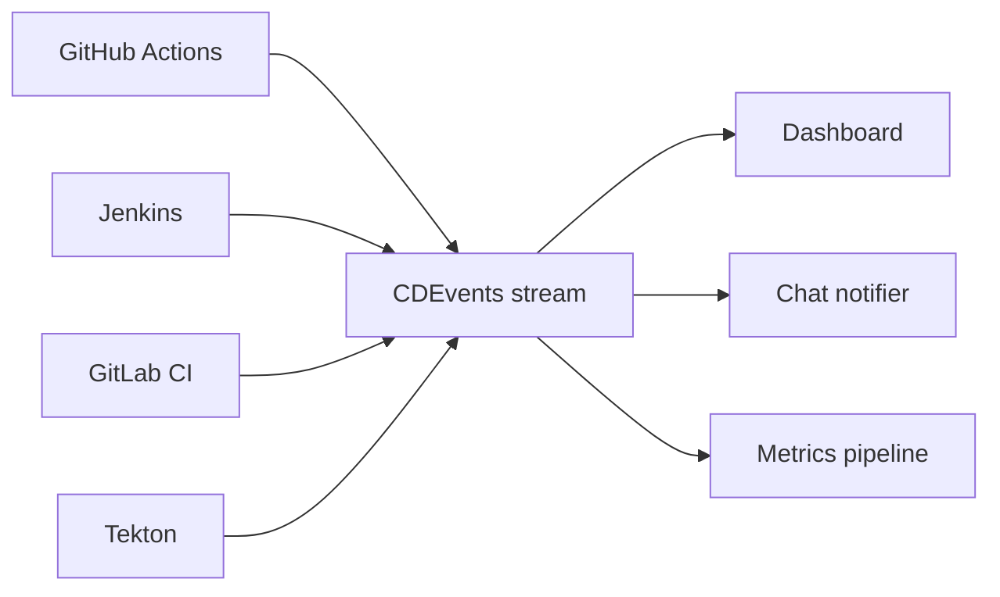

# One event stream from many CI/CD tools

_When several CI/CD tools feed several consumers, every tool and consumer pair needs its own integration. Convert the events of each tool to one shared format, CDEvents, and the count drops from N × M to N + M._

## How you end up with four CI/CD tools

Nobody plans it. New repositories use GitHub Actions. The legacy monolith has run on Jenkins since 2016. A team from an acquisition brings GitLab CI, and the platform team picks Tekton because it runs natively on Kubernetes.

Then someone asks for one deployment dashboard. Or for a chat bot that posts every failed pipeline in Slack or Microsoft Teams. Each request becomes a script that reads the webhook format of one tool.

## Every tool and consumer pair is an integration

Take 4 CI/CD tools and 3 consumers: a dashboard, a chat notifier and a metrics pipeline. Each consumer must parse the payload of each tool. That is 4 × 3 = 12 integrations.

Each integration depends on the quirks of one tool. When GitHub renames a webhook field, all three consumers can break. A fifth tool adds 3 integrations, and a fourth consumer adds 4.

## Put one format between tools and consumers

Moving every team to one CI/CD tool is rarely possible. Acquired teams and legacy systems keep the mix alive.

The other option is to convert the events of each tool to one shared format. Each tool then needs one converter. Each consumer reads one format and does not care which tool sent the event.

## CDEvents is that format

[CDEvents](https://cdevents.dev/) is an open specification from the Continuous Delivery Foundation (CDF). It defines event types for pipelines, builds, tests, deployments and incidents. Each event has a `context` block (spec version, type, timestamp) and a `subject` block (what the event is about).

Here is a finished GitHub Actions workflow run, converted by the `github_events` transformer of cdviz-collector:

```json
{
  "context": {
    "specversion": "0.5.0",
    "timestamp": "2025-01-22T19:03:50+00:00",
    "type": "dev.cdevents.pipelinerun.finished.0.3.0"
  },
  "subject": {
    "id": "https://api.github.com/repos/acme/api/actions/runs/11111111111/attempts/1",
    "content": {
      "pipelineName": "acme/api/deploy",
      "outcome": "success",
      "uri": "https://github.com/acme/api/actions/runs/11111111111/attempts/1"
    }
  }
}
```

And a finished Jenkins build, converted by the `jenkins_rest_api` transformer:

```json
{
  "context": {
    "specversion": "0.5.0",
    "timestamp": "2025-01-22T19:07:12+00:00",
    "type": "dev.cdevents.pipelinerun.finished.0.3.0"
  },
  "subject": {
    "id": "https://jenkins.example.com/job/team-a/job/service/job/main/43/",
    "content": {
      "pipelineName": "team-a/service/main",
      "outcome": "failure",
      "uri": "https://jenkins.example.com/job/team-a/job/service/job/main/43/"
    }
  }
}
```

Both events come from the test fixtures of [transformers-community](https://github.com/cdviz-dev/transformers-community), shortened for this page. The `customData` block, which keeps tool-specific data, is removed.

The `type` is the same, and so are the `subject.content` fields. A consumer that counts failed pipelines reads `outcome` and ignores the tool. When a consumer needs a detail that only one tool provides, it reads `customData`.

## N × M becomes N + M

Each tool connects once, to the event stream. Each consumer connects once, to the same stream.



|                      | Without a shared format        | With CDEvents                 |
| -------------------- | ------------------------------ | ----------------------------- |
| Integrations needed  | 4 tools × 3 consumers = **12** | 4 tools + 3 consumers = **7** |
| One more tool        | +3 integrations                | +1 integration                |
| One more consumer    | +4 integrations                | +1 integration                |
| 6 tools, 5 consumers | 30 integrations                | 11 integrations               |

The gap grows with every tool and every consumer you add.

## Common mistakes

- **Using the webhook format of one tool as the standard.** The other tools still need a converter to that format. And the vendor can change that format at any release.
- **Sending raw webhooks to every consumer.** Each consumer then contains a parser for each tool. This is the N × M problem again, spread over more code.
- **Waiting to consolidate on one CI/CD tool.** The migration is long, and the next acquisition can bring a new tool. Normalized events work during the migration and after it.

## Collect events from your tools

Some tools emit CDEvents natively. Tekton is one of them: it can POST its events to a collector with no transformer (see the [CDEvents integration](/docs/integrations/cdevents)).

For the other tools, cdviz-collector ships open source transformers, for example for [GitHub](/docs/integrations/github), [GitLab](/docs/integrations/gitlab) and [Jenkins](/docs/integrations/jenkins). The [integrations page](/docs/integrations/) lists every supported source.

CDviz is one implementation of CDEvents. Other tools in the [CDEvents ecosystem](/docs/cdevents#cdevents-ecosystem) also produce and consume these events.
